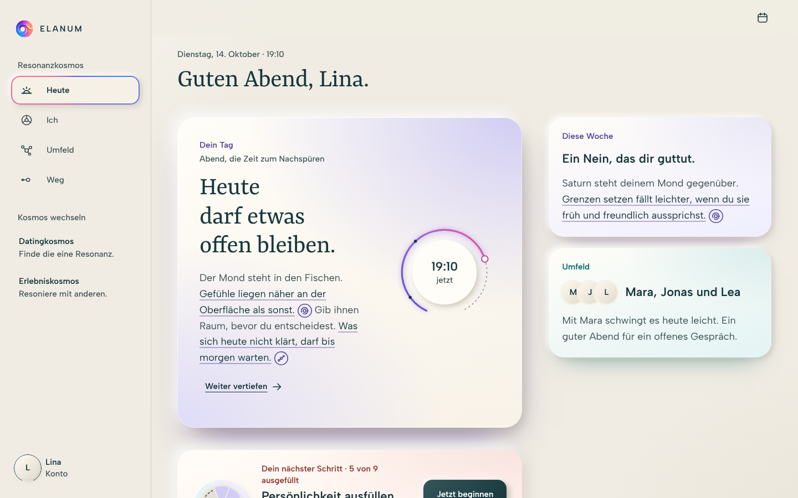
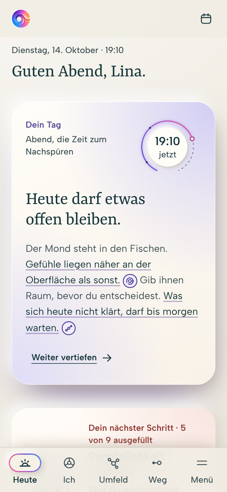
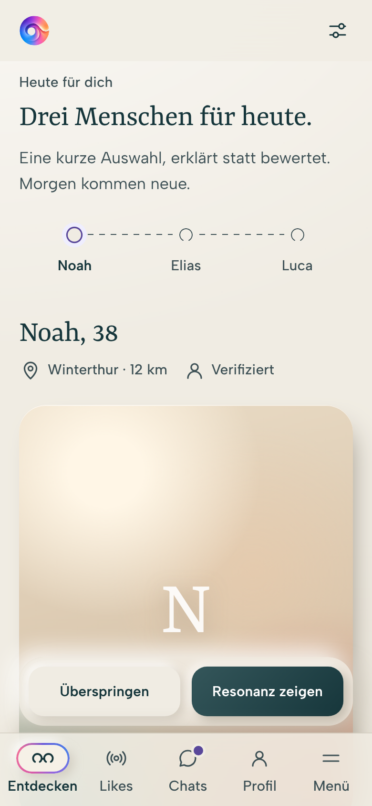
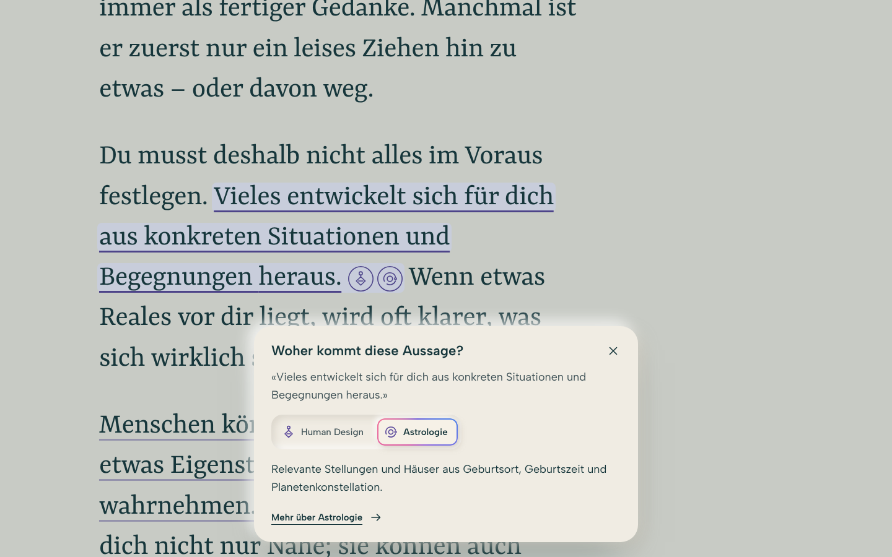
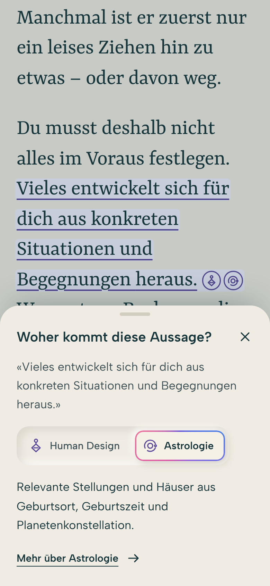

# ELANUM Gestaltungsatlas 4.11


<table>
  <tr>
    <td width="66%"></td>
    <td width="34%"></td>
  </tr>
  <tr>
    <td>Resonanzrad</td>
    <td>Auf dem Telefon</td>
  </tr>
</table>

<table>
  <tr>
    <td width="66%"></td>
    <td width="17%"></td>
    <td width="17%"></td>
  </tr>
  <tr>
    <td>App am Desktop</td>
    <td>Heute</td>
    <td>Entdecken</td>
  </tr>
</table>

<table>
  <tr>
    <td width="66%"></td>
    <td width="34%"></td>
  </tr>
  <tr>
    <td>Fliesstext: Woher kommt diese Aussage?</td>
    <td>Auf dem Telefon</td>
  </tr>
</table>

Der interaktive ELANUM-Gestaltungsatlas im Stil **Soft 3D Relief**, mit den Bausteinen Resonanzrad, Umfeld, Beziehungsraum, Weg und Tageslinie, dem Zeichen in Bewegung, dem App-Rahmen und dem Fliesstext. Im Zentrum steht das Resonanzrad mit seinen neun Elementen. Seit 4.10 zeigt der Atlas, wie die App aussieht: mobile zuerst, in jeder Breite.

[Atlas öffnen](index.html) · [App-Screens](components/app/) · [Gestaltungsnotizen](DESIGN-NOTES.md) · [Bausteine](components/)

**Benennung:** Im Zentrum steht das Resonanzrad mit neun Elementen. ELANUM hat drei Kosmen: den **Resonanzkosmos** als Einstieg, daneben den **Datingkosmos** und den **Erlebniskosmos**. Verbindlich ist das [Glossar](GLOSSAR.md).

## Was der Atlas zeigt

- **Zeichen:** das ELANUM-Zeichen, vollständig aus Kreisbögen konstruiert, alle Radien im Goldenen Schnitt. Spektrum, Ink, Invers, Papierrelief und Blueprint. Seine Form bewegt sich nie, nur Licht und Farbe bewegen sich darin: einmal im Zeichenaufbau oder dauernd im Lichtlauf, gross wie klein.
- **Typografie:** fünf Stufen. Albert Sans trägt die Bedienung, Yrsa ist die Stimme und erscheint nur gross. Kein Kursiv, nichts unter 15 px.
- **Farbe:** neutrale Flächen, drei ausgeglichene Bereichsfarben des Resonanzrads (Violett, Koralle, Petrol) mit Tief, Fläche für ausgefüllte Elemente und Hauch; offene Elemente grau mit Plus, das Markenspektrum nur für Zeichen und Verbindung, kräftige Statusfarben mit Zeichen und Balken.
- **Material:** warme Reliefoberfläche, Licht von links oben, angehobene Bedienung, vertiefte Eingaben.
- **Bausteine:** Resonanzrad, Umfeld, Beziehungsraum, Weg und Tageslinie, Zeichen in Bewegung, App-Rahmen, Fliesstext, je als eigene Seite unter `components/` und im Atlas eingebunden.
- **In der App:** acht Screens als echte, responsive Seiten (Heute, Ich, Umfeld, Weg, Entdecken, Chats, Aktivitäten, Ankommen). Im Atlas in Telefon- und Desktop-Rahmen nebeneinander oder in freier Breite von 320 bis 1440 px. Dazu die Navigation in drei Formen, acht Regeln für mobile zuerst, was von vergleichbaren Plattformen übernommen wurde und was sich gegenüber der heutigen App ändert.
- **Fliesstext:** ein Text, der zu dir spricht und bei jeder Kernaussage zeigt, woher sie kommt. Die Aussage ist leise unterstrichen, am Satzende steht für jedes Element eine runde Quelle mit seinem Icon, Antippen öffnet die Quellenkarte „Woher kommt diese Aussage?“. Als Stimme für dein erstes Muster, leise in den Karten der App.
- **Bewegung:** erklärend statt nur einblendend. Das Zeichen baut sich im Einstieg aus seiner Konstruktion auf, das Resonanzrad beim Scrollen, Kreise rücken zusammen, Spuren zeichnen sich. Pause und reduzierte Bewegung wirken überall.

## Lokal öffnen

Das Repository herunterladen und `index.html` im Browser öffnen. Alle Dateien und den Ordner `assets/` zusammen behalten. GitHub selbst zeigt HTML als Quelltext.

Alternativ mit Git und Python 3:

```bash
git clone --branch main https://github.com/maindnow/elanum-design.git
cd elanum-design
python3 tools/serve.py
```

Danach [http://127.0.0.1:4173](http://127.0.0.1:4173) öffnen. Den Server mit `Ctrl+C` beenden. `tools/serve.py` schaltet den Browser-Cache ab, so zeigt der Browser nach einem Wechsel des Branches nie einen alten Stand.

Kein Paketmanager, Build oder Backend erforderlich. Schriften und SVG-Assets liegen lokal. Die Eingaben dienen nur der aktuellen Vorschau, ohne Versand oder dauerhafte Speicherung.

## Aufbau

| Datei | Aufgabe |
| --- | --- |
| [index.html](index.html) | Atlas mit allen Kapiteln |
| [tokens.css](tokens.css) | Eine Quelle für Farben, Schrift, Raum, Relief und Bewegung |
| [base.css](base.css) | Gemeinsame Bausteine: Schriftstufen, Buttons, Status, Element-Chip, Stationslinie, Seitenrahmen |
| [style.css](style.css) | Layout des Atlas |
| [app.js](app.js) | Bedienlogik des Atlas |
| [components/](components/) | Bausteine als eigene Seiten: `resonanzrad`, `umfeld`, `beziehungsraum`, `weg`, `zeichen`, `app`, `fliesstext` |
| [components/app/](components/app/) | App-Rahmen (`app.css`, `app.js`), die Screens als Beispielseiten (`heute.html` …, `screens.css`, `screens.js`) und die Gerätevorschau (`vorschau.css`, `vorschau.js`) |
| [assets/boot.js](assets/boot.js) | Versteck-Guard, Schriften unter `file://`, GSAP nach dem ersten Paint |
| [assets/motion.js](assets/motion.js) | Alle Bewegung, deklarativ über `data-anim` |
| [assets/vendor/gsap/](assets/vendor/gsap/) | GSAP 3.15 lokal, mit Lizenzhinweis |
| [tools/embed-fonts.py](tools/embed-fonts.py) | Erzeugt `assets/fonts/fonts-embedded.css` neu |
| [tools/build_logo_circles.py](tools/build_logo_circles.py) | Erzeugt das ELANUM-Zeichen im Goldenen Schnitt (Ink, Spektrum, Blueprint) und die Konstruktion für den Zeichenaufbau in `components/zeichen/zeichen.js`, prüft Knicke; mit `--masks` die Relief-Maske. Nur Python-Standardbibliothek |
| [tools/serve.py](tools/serve.py) | Lokaler Server auf Port 4173 ohne Browser-Cache. Nur Python-Standardbibliothek |
| [tools/screenshots.js](tools/screenshots.js) | Erzeugt die Screenshots in `docs/screenshots/` neu, auch die der App (Server auf Port 4173, braucht Playwright) |
| [assets/glossar.js](assets/glossar.js) | Glossar: die eine Quelle aller Begriffe |
| [GLOSSAR.md](GLOSSAR.md) | Glossar als Datei, erzeugt mit `node tools/glossar-md.js` |
| [DESIGN-NOTES.md](DESIGN-NOTES.md) | Gestaltungs- und Konstruktionsentscheidungen |
| [package.json](package.json) | Paket `@elanum/design` für die App: Version, ausgelieferte Dateien, Einstiege |

Die Stylesheets laden in der Reihenfolge `tokens.css`, `base.css`, Element-Stylesheets, `style.css`.

## In der App verwenden

Dieses Repository ist die einzige Designquelle der App ELANUM. Die App installiert es als Paket `@elanum/design` direkt von GitHub, fixiert auf einen Tag. Die Paketversion ist die Atlas-Version: Atlas 4.11 ist `4.11.0`, der Tag dazu `v4.11.0`.

### Installation

In der `package.json` der App:

```json
"dependencies": {
  "@elanum/design": "github:maindnow/elanum-design#v4.11.0"
}
```

Danach `npm install`. Für eine neue Version nur den Tag anheben und `npm install` erneut ausführen. Das Paket hat keine Abhängigkeiten und keinen Build-Schritt.

Ausgeliefert wird nur, was die App braucht (`files` in [package.json](package.json), prüfen mit `npm pack --dry-run`):

| Im Paket | Inhalt |
| --- | --- |
| `tokens.css`, `base.css` | Alle Werte und die gemeinsamen Grundlagen, auch Weg und Tageslinie (`.track`) |
| `components/<name>/<name>.css` und `.js` | Resonanzrad, Umfeld, Beziehungsraum, Zeichen, App-Rahmen (`components/app/app.css`, `app.js`), Fliesstext |
| `assets/ELANUM-*-Harmonic.svg` | ELANUM-Zeichen: Spektrum, Ink, Blueprint |
| `assets/fonts/` | Albert Sans und Yrsa mit OFL-Lizenzen, dazu die eingebetteten Schriften für `file://` |
| `assets/boot.js`, `assets/motion.js`, `assets/vendor/gsap/` | Bewegung, GSAP mit Lizenzhinweis |
| `assets/glossar.js`, `GLOSSAR.md` | Glossar |

Atlas (`index.html`, `style.css`, `app.js`), die Demoseiten der Bausteine (`index.html`, `page.css`, `page.js`, `weg.css`), die App-Screens mit ihren Daten (`components/app/*.html`, `screens.css`, `screens.js`, `vorschau.*`), frühere Fassungen des Zeichens, `docs/` und `tools/` bleiben im Repository, aber ausserhalb des Pakets.

Einstiege (`exports`) für Bundler und `require.resolve`: `@elanum/design/tokens.css`, `/base.css`, `/components/*`, `/assets/*`, `/glossar` (`assets/glossar.js`) und `/package.json`.

### Assets unter einem festen Pfad

Die Dateien verweisen relativ aufeinander: `tokens.css` lädt die Schriften aus `assets/fonts/`, `boot.js` lädt GSAP und `motion.js` aus `assets/`. Die App liefert den Paketordner deshalb unverändert unter einem festen Pfad aus, hier `/elanum/`. Zum Beispiel bei jedem `npm install` in den statischen Ordner kopieren:

```json
"scripts": {
  "postinstall": "node -e \"const fs=require('fs');fs.rmSync('public/elanum',{recursive:true,force:true});fs.cpSync('node_modules/@elanum/design','public/elanum',{recursive:true})\""
}
```

`public/elanum/` gehört dann in die `.gitignore` der App. Ein eigener Server kann den Ordner auch direkt ausliefern, `require.resolve('@elanum/design/package.json')` findet ihn.

`boot.js` erfährt den Pfad über `data-base`, mit Schrägstrich am Ende:

```html
<script src="/elanum/assets/boot.js" data-base="/elanum/"></script>
```

### Ladereihenfolge

```html
<head>
  <script src="/elanum/assets/boot.js" data-base="/elanum/"></script>
  <link rel="stylesheet" href="/elanum/tokens.css">
  <link rel="stylesheet" href="/elanum/base.css">
  <link rel="stylesheet" href="/elanum/components/beziehungsraum/beziehungsraum.css">
  <link rel="stylesheet" href="/elanum/components/resonanzrad/resonanzrad.css">
  <link rel="stylesheet" href="/elanum/components/umfeld/umfeld.css">
  <link rel="stylesheet" href="/elanum/components/zeichen/zeichen.css">
  <link rel="stylesheet" href="/elanum/components/app/app.css">
  <link rel="stylesheet" href="/app.css">
</head>
<body>
  …
  <script src="/elanum/components/beziehungsraum/beziehungsraum.js"></script>
  <script src="/elanum/components/resonanzrad/resonanzrad.js"></script>
  <script src="/elanum/components/umfeld/umfeld.js"></script>
  <script src="/elanum/components/zeichen/zeichen.js"></script>
  <script src="/elanum/components/app/app.js"></script>
  <script src="/elanum/assets/glossar.js"></script>
  <script src="/app.js"></script>
</body>
```

1. `boot.js` synchron im `<head>`, vor allen Stylesheets. Es setzt den Versteck-Guard und lädt GSAP und `motion.js` nach dem ersten Paint selbst.
2. `tokens.css`: alle Werte und die Schriften.
3. `base.css`: setzt `tokens.css` voraus.
4. Stylesheets der Bausteine, nur die gebrauchten. `umfeld.css` braucht `beziehungsraum.css` (Relief der Kreise). `app.css` ist der Rahmen jeder Seite der App.
5. Eigene Stylesheets der App zuletzt.

Die Skripte der Bausteine stehen am Ende von `<body>`, die App montiert die Bausteine gleich beim Laden. `motion.js` liest das Markup einmal nach `document.fonts.ready`; was später erscheint, steht ohne Auftritt da, aber nie versteckt.

### Globale API

Jeder Baustein ist ein klassisches Skript und legt ein Objekt auf `window`. Mit einem Bundler genügt ein Import ohne Namen, etwa `import '@elanum/design/components/resonanzrad/resonanzrad.js'`.

**Resonanzrad** · `components/resonanzrad/` · `window.ElanumResonanzrad`

- `mount(root, { heading })` baut das Rad in `root` und gibt `{ select(i), parts }` zurück. `heading` ist `'h2'` (Standard) oder `'h3'`.
- `mini(root, { done, focus, label })` zeichnet ein kleines Rad für Karten (ohne Schrift, ohne Bedienung) und gibt `{ done, total }` zurück. `done` ist die Liste der ausgefüllten Element-ids, `focus` das Element, das als Nächstes wartet: sein Stück hebt sich ab und glüht.
- `groups`, `items`, `icons`, `iconSvg(id)`: Bereiche, Elemente und ihre Icons.

```html
<div data-anim="resonanzrad"><div data-resonanzrad></div></div>
<script>
  const rad = ElanumResonanzrad.mount(document.querySelector('[data-resonanzrad]'), { heading: 'h2' });
  rad.select(4);
</script>
```

**Umfeld** · `components/umfeld/`, dazu `beziehungsraum.css` · `window.ElanumUmfeld`

- `mount(root, { link, heading })` zeichnet Ich und die Menschen darum und gibt `{ select(i), parts }` zurück. `link` führt zum Beziehungsraum, ergänzt um `?person=…&proximity=…&resonance=…`.
- `people`: die Menschen der Vorschau.

```html
<div data-umfeld data-anim="umfeld"></div>
<script>
  ElanumUmfeld.mount(document.querySelector('[data-umfeld]'), { link: '/beziehungsraum/', heading: 'h3' });
</script>
```

**Beziehungsraum** · `components/beziehungsraum/` · `window.ElanumBeziehung`

- `mount(el)`, `mountAll(root)`: zeichnet jeden Rahmen mit `data-beziehung`. Startwerte aus `data-proximity`, `data-resonance`, `data-openness`, `data-dark` für dunklen Grund.
- `set(el, { proximity, resonance, openness }, immediate)`: Nähe, Resonanz und Freiraum, je 0 bis 100.
- `setMode(el, 'spectrum' | 'ink')`, `setPaused(bool)`, `isPaused()`, `onPhase(fn)` für die Atmung, `redraw()`.

```html
<div class="relationship-frame" data-beziehung data-anim="beziehung" role="img" aria-label="Zwei runde, offene Konturen, verbunden durch eine kurze gebogene Linie.">
  <svg viewBox="0 0 720 400" aria-hidden="true"></svg>
  <div class="relationship-label" data-person="a">Du<span>dein Raum</span></div>
  <div class="relationship-label" data-person="b"><span data-name>Mara</span><span>ihr Raum</span></div>
</div>
<script>
  ElanumBeziehung.set(document.querySelector('[data-beziehung]'), { proximity: 58, resonance: 72, openness: 34 });
</script>
```

**Zeichen in Bewegung** · `components/zeichen/` · `window.ElanumZeichen`

Die Form des Zeichens bewegt sich nie. Unter der Bewegung liegt immer die unveränderte Datei `ELANUM-Master-Spektrum-Harmonic.svg`, sie wird nur einmal gezeichnet. Bewegt werden Deckkraft und Drehung leichter Ebenen darüber. `data-zeichen` wählt die Bewegung:

- `aufbau`: Zeichenaufbau, einmal, knapp 3 s. Aussenkreis und Öffnung zeichnen sich als feine Linie im Markenspektrum, dann füllt sich das Zeichen sanft mit Farbe. Startet, sobald das Zeichen zu sehen ist.
- `lichtlauf`: Lichtlauf, dauernd, 24 s pro Umlauf.

- `mount(root, { bewegung })` gibt `{ play(), stop(), parts }` zurück. `play()` baut das Zeichen neu auf, `stop()` zeigt sofort das ruhende Zeichen.
- `mountAll(scope)`: montiert jedes `[data-zeichen]`.

Ohne Skript steht das Bild. Bei reduzierter Bewegung, in der Pause (`body[data-motion=off]` und `elanum:motion`) und nach Tab steht das ruhende Zeichen.

```html
<div class="zeichen" data-zeichen="lichtlauf"></div>
<script>
  ElanumZeichen.mountAll();
</script>
```

**Weg und Tageslinie** · in `base.css` · ohne Skript

Reines Markup mit `.track`, waagrecht als Weg mit `.track--horizontal`. Jede Station trägt `data-state="done"`, `"now"` oder `"open"`. `data-anim="track"` zeichnet die Spur beim Erreichen, mit `data-scrub` an den Scroll gekoppelt.

```html
<ol class="track track--horizontal" data-anim="track" data-scrub>
  <li class="track__station" data-state="done"><span class="track__marker"></span><span class="track__seg"></span><div><span class="track__when">März</span><h3 class="track__title">Erkennen</h3><p class="track__text">Was dich bewegt, bekommt einen Namen.</p></div></li>
  <li class="track__station" data-state="now"><span class="track__marker"></span><span class="track__seg"></span><div><span class="track__when">Jetzt</span><h3 class="track__title">Hier bist du</h3><p class="track__text">Du übst, was dir wichtig ist.</p></div></li>
  <li class="track__station" data-state="open"><span class="track__marker"></span><span class="track__seg"></span><div><span class="track__when">Später</span><h3 class="track__title">Noch offen</h3><p class="track__text">Der nächste Schritt entsteht unterwegs.</p></div></li>
</ol>
```

**App-Rahmen** · `components/app/` · `window.ElanumApp`

Der Rahmen jeder Seite: Navigation, Kopf, Inhalt, Sheet und die Muster der Kosmen. Mobile zuerst, drei Formen der Navigation mit denselben Zielen:

| Breite | Navigation | Inhalt |
| --- | --- | --- |
| bis 599 px | Leiste unten, höchstens fünf Ziele, das letzte ist „Menü“ | eine Spalte, Handlungen schweben über der Leiste |
| 600 bis 1023 px | Schiene links, Icon über dem Namen | Karten in zwei Spalten |
| ab 1024 px | Seitenleiste, nach Kosmos gegliedert, „Kosmos wechseln“ immer sichtbar | Haupt- und Begleitspalte, Liste und Detail nebeneinander |

Karten und Spalten richten sich nach dem Platz im Inhalt (Container Queries auf `.app-main`), nicht nach dem Fenster. Der aktive Ort trägt den Glührand im Atemtakt. Zwischen Seiten gleitet er weich zum neuen Ziel (View Transitions), Navigation und Kopf bleiben stehen.

- `mount({ kosmos, current, href, base, me })` baut die Navigation in `[data-app-nav]` und das Menü, verbindet Kopf und Sheets und hört auf die Pause aus dem Atlas. `kosmos` ist `'resonanz'`, `'dating'` oder `'erleben'`, `current` die id des Ziels, `href(id)` liefert die Adresse.
- `nav(el, opts)`: nur die Navigation.
- `sheet(dialog)` gibt `{ open(trigger), close() }`: von unten auf dem Telefon, in der Mitte auf dem Tablet, von rechts auf dem Desktop. Schliessen mit Knopf `[data-close]`, Tipp daneben oder Esc, der Fokus kehrt zum Auslöser zurück. `data-sheet-open="id"` an einem Knopf öffnet ein `<dialog data-sheet>`.
- `dayArc(el, { now, stations, from, to })` zeichnet den Tagesbogen für die Hauptfläche.
- Mit erlaubter Bewegung setzt `mount` die Klasse `app-in` auf `<html>`: Inhalt steigt auf, der Tagesbogen zeichnet sich, das kleine Rad baut sich auf. Pause und reduzierte Bewegung zeigen sofort den Endzustand.
- `kosmen`, `more`, `icons`, `iconSvg(id)`, `fillIcons(root)`: Ziele je Kosmos, Einträge im Menü und die Icons der Navigation.
- Das ELANUM-Zeichen in Navigation und Kopf kommt aus dem Baustein Zeichen: `zeichen.css` und `zeichen.js` vor `app.js` laden, dann trägt es den Lichtlauf. Beim ersten Start (Ankommen) baut es sich auf (`data-zeichen="aufbau"`).

```html
<body class="app">
  <a class="skip-link" href="#main">Direkt zum Inhalt</a>
  <nav data-app-nav></nav>
  <header class="app-head">
    <a class="app-head__brand" href="/heute"><span class="zeichen" data-zeichen="lichtlauf"></span></a>
    <p class="app-head__title" aria-hidden="true"></p>
    <div class="app-head__actions">…</div>
  </header>
  <main class="app-main" id="main" tabindex="-1">
    <header class="app-pagehead"><p class="app-kicker">Dienstag, 14. Oktober</p><h1 class="app-title">Guten Abend, Lina.</h1></header>
    <article class="app-hero">…</article>
    <div class="app-actions"><button class="button button--secondary">Später</button><button class="button">Weiter</button></div>
  </main>
  <script>ElanumApp.mount({ kosmos: 'resonanz', current: 'heute', href: id => '/' + id, base: '/elanum/' });</script>
</body>
```

Muster in `app.css`: `.app-card`, `.app-card--tint` (Karte in der Farbe ihres Bereichs), `.app-hero` (Hauptfläche in weichem Licht, ein Moment pro Screen, `data-area` für die Farbe, `.app-hero--dark` nur für den Beziehungsraum), `.app-flip` (Frage zum Umdrehen, `data-flip`), `.app-layout` und `.app-grid` (Spalten nach Platz), `.app-split` (Liste und Detail), `.app-list` mit `.app-row`, `.person` (eigener, offener Kreis), `.profile`, `.photo`, `.note`, `.prompt`, `.event`, `.bubble`, `.app-composer`, `.app-steps`, `.app-field`, `.app-check`, `.app-actions`, `.app-end`. Die Beispielseiten unter `components/app/` zeigen jedes Muster im Einsatz. Der Element-Chip (`.element-chip`, `.element-chips`) liegt seit 4.11 in `base.css`, weil ihn auch der Fliesstext braucht.

**Fliesstext** · `components/fliesstext/` · `window.ElanumFliesstext`

Ein Text, der zu einem Menschen spricht und bei jeder Kernaussage zeigt, woher sie kommt. Ruhig zu lesen, neugierig zu öffnen. Drei Teile:

- **Aussage:** `<mark class="fliesstext__aussage" data-quellen="…">`, leise unterstrichen in der Farbe ihres Bereichs, nie wie ein Link. Geöffnet bekommt sie den Hauch des Bereichs als Grund.
- **Quelle:** am Satzende ein runder Knopf für jedes Element aus `data-quellen` (ids aus `ElanumResonanzrad.items`), mit dessen Icon und Bereichsfarbe. Astrologie, Numerologie und Human Design sind alle Violett, das Icon unterscheidet. Der Name erscheint bei Hover und Fokus und bleibt im Fenster. Sichtbar 0,86 em, Trefferfläche 44 px. Das letzte Wort bleibt mit den Quellen in einer Zeile.
- **Quellenkarte:** ein `<dialog>` „Woher kommt diese Aussage?“ mit dem Satz, dem Element (bei mehreren eine Auswahl), der Herleitung und „Mehr über …“, wenn ein Ziel da ist. Telefon von unten, ab 600 px schwebend über dem unteren Rand. Liegt die Aussage hinter der Karte, rollt die Seite sie darüber. Esc, Schliessen und ein Tipp daneben schliessen, der Fokus kehrt zur Quelle zurück.

Zwei Stufen: `.fliesstext` ist die Stimme (Yrsa, Stufe Titel) für den Moment, in dem ELANUM zu dir spricht, etwa dein erstes Muster. `.fliesstext--leise` ist Albert Sans in der Stufe Text, für Karten. Die Legende `.fliesstext-legende` zeigt die Quellen eines Textes als Element-Chips.

- `mount(root, { quellen, titel })` gibt `{ open(aussage, id), close() }`. `quellen` ist `{ id: { text, href, mehr } }` oder `function (id, aussage)`, `titel` ersetzt den Titel der Karte.
- `mountAll(opts)`: montiert jedes `[data-fliesstext]` und füllt jede `[data-fliesstext-legende]`.
- `legende(el)`: nur eine Legende.

Setzt `resonanzrad.js` voraus (Namen, Bereich und Icon der Elemente). Ohne Skript bleibt ein ruhiger Text mit leise unterstrichenen Aussagen.

```html
<link rel="stylesheet" href="/elanum/components/fliesstext/fliesstext.css">
<div class="fliesstext" data-fliesstext>
  <p><mark class="fliesstext__aussage" data-quellen="human-design astrology">Vieles entwickelt sich für dich aus konkreten Situationen und Begegnungen heraus.</mark> Wenn etwas Reales vor dir liegt, wird oft klarer, was sich wirklich stimmig anfühlt.</p>
</div>
<ul class="fliesstext-legende" data-fliesstext-legende="astrology numerology human-design" aria-label="Quellen"></ul>
<script src="/elanum/components/resonanzrad/resonanzrad.js"></script>
<script src="/elanum/components/fliesstext/fliesstext.js"></script>
<script>
  ElanumFliesstext.mountAll({ quellen: {
    'human-design': { text: 'Profil 4/6: deine bewusste und unbewusste Linie.', href: '/ich/human-design' },
    'astrology': { text: 'Stellungen und Häuser aus Geburtsort, Geburtszeit und Planetenkonstellation.', href: '/ich/astrologie' }
  } });
</script>
```

**Glossar** · `assets/glossar.js`, Einstieg `@elanum/design/glossar` · `window.ELANUM_GLOSSAR`

`{ version, rule, sentence, groups: [{ title, intro, terms: [{ term, meaning, code }] }], avoid: [[alt, neu]] }`

```js
const resonanz = ELANUM_GLOSSAR.groups.flatMap(g => g.terms).find(t => t.term === 'Resonanz');
```

**Bewegung** · `assets/boot.js`, `assets/motion.js` · Ereignisse auf `document`

Das Markup sagt mit `data-anim`, was sich bewegt: `hero`, `title`, `reveal`, `stagger`, `ramp`, `beziehung`, `resonanzrad`, `umfeld`, `track`. Reduzierte Bewegung gilt von selbst. `motion.js` hört auf drei Ereignisse:

- `elanum:motion` mit `{ off: true }` beendet alle Auftritte.
- `elanum:layout` nach einem Layoutwechsel berechnet die Scrollstrecken neu.
- `elanum:status` mit `{ element }` lässt einen Status kurz auftreten.

Eine Pause für alles, wie im Atlas:

```js
document.body.dataset.motion = 'off';
ElanumBeziehung.setPaused(true);
document.dispatchEvent(new CustomEvent('elanum:motion', { detail: { off: true } }));
```

## Gestaltungsregeln

- **Zeichen in Spektrum.** Als Marke steht in App, Atlas und Favicon immer `ELANUM-Master-Spektrum-Harmonic.svg`, auch klein. Es darf sich bewegen, seine Form nie: in Navigation und Kopf der App mit Lichtlauf, beim ersten Start im Zeichenaufbau. Ink nur, wo nur eine Farbe geht: Druck, Prägung, Stempel.
- **Mobile zuerst.** Jeder Screen wird zuerst für 360 bis 390 px gebaut und auf 320, 390, 834, 1280 und 1440 px geprüft. Navigation und Hauptaktion in der Daumenzone, ein Hauptmoment in weichem Licht pro Screen, jede Geste mit Knopf, ein ruhiges Ende statt Endlosliste.
- **Zeichen aus Kreisen.** Gültig ist `-Harmonic`: jede Kontur ein Kreisbogen, alle Radien aus der Reihe R · φ^(−k/4) (Goldener Schnitt), Übergänge ohne Knick. `ELANUM-Konstruktion-Harmonic.svg` zeigt die Konstruktion. Diese Dateien und die Zeile `var K` in `components/zeichen/zeichen.js` nie von Hand bearbeiten, sondern mit `python3 tools/build_logo_circles.py` neu erzeugen; die Relief-Maske in `app.js` (`RELIEF_MASK`) kommt aus `python3 tools/build_logo_circles.py --masks`. Dateien ohne Suffix sind die unveränderten Quellen, `-Curves` ist die frühere Kurvenkorrektur, `-Geometrisch` die verworfene Alternative aus sechs Grundkreisen.
- **Fünf Schriftstufen.** Display, Titel, Überschrift, Text, Label. Neue Texte verwenden eine dieser Stufen.
- **Farbe hat eine Rolle.** Neutral, Bereich oder Status. Weisse Schrift nur auf Tief, Ink auf dem Hauch; auf den Elementen im Rad steht Text nur in Ink.
- **Raum statt Rahmen.** Abstand gliedert, Linien trennen nur Kapitel.
- **Bewegung erklärt und bleibt kontrollierbar.** Jede Animation zeigt eine Beziehung, Reihenfolge oder einen Zustand. Keine Animation versteckt Inhalte dauerhaft; Pause, Tastatur und `prefers-reduced-motion` beenden alle Auftritte.
- **Begriffe aus dem Glossar.** Neue oder geänderte Begriffe nur in `assets/glossar.js`, danach `node tools/glossar-md.js`.
- **Dokumentation mitpflegen.** Bei Änderungen an Tokens `tokens.css` anpassen; Palette und Tokenblock lesen die Werte daraus. Nach Änderungen an Schriften `python3 tools/embed-fonts.py` ausführen.

## Prüfen

```bash
for f in app.js assets/*.js components/*/*.js; do node --check "$f"; done
python3 tools/build_logo_circles.py
git diff --check
```

Zusätzlich im Browser, für den Atlas und jede Seite unter `components/`:

- Desktop, Tablet und Telefon: kein horizontaler Überlauf, Texte nie unter 15 px. Die App-Screens auf 320, 390, 834, 1280 und 1440 px.
- App: Navigation in allen drei Formen, Sheets mit Esc und Fokus zurück, Chat auf dem Telefon ohne Leiste, Zusage im Sheet.
- Fliesstext: Quelle per Tipp und Tastatur, Wechsel der Quelle in der Karte, Esc und Tipp daneben mit Fokus zurück, die Aussage bleibt über der Karte sichtbar, Trefferflächen 44 px.
- Resonanzrad: Auswahl per Tipp, Liste und Tastatur; Ausfüllstatus über Farbe und Kontur.
- Bewegung: Einstieg mit Zeichenaufbau, festgehaltenes Resonanzrad-Kapitel, Pause, reduzierte Bewegung, Tab-Durchlauf. In der Pause steht das ruhende Zeichen.
- Assets: keine fehlenden Dateien oder Konsolenfehler, auch unter `file://`.

## Stand und Historie

4.11 bringt den Baustein Fliesstext unter `components/fliesstext/`: Aussagen mit ihrer Quelle am Satzende und der Quellenkarte „Woher kommt diese Aussage?“, als Stimme für dein erstes Muster und leise in Karten. Im Atlas im Kapitel Sprache, in der App auf Heute (ersetzt dort die Chips unter dem Text). Der Element-Chip liegt jetzt in `base.css`. 4.10 zeigt ELANUM als App: neuer Baustein App-Rahmen (Navigation in drei Formen, Kopf, Sheet, Hauptfläche in weichem Licht, Tagesbogen, Frage zum Umdrehen, Muster der Kosmen), acht Screens als echte, responsive Seiten auf Grundlage der heutigen App, im Atlas das Kapitel „In der App“ mit Gerätevorschau. Das Zeichen steht als Marke überall in Spektrum, in der App mit Lichtlauf und Zeichenaufbau. Dazu `ElanumResonanzrad.mini()` und eine Korrektur der Verläufe der Bereiche, die leere Farbstopps zeigten. 4.9 lässt das ELANUM-Zeichen sich bewegen. Seine Form steht, nur Licht und Farbe bewegen sich: Zeichenaufbau (einmal) und Lichtlauf (dauernd), gross wie klein. Neuer Baustein `components/zeichen/`, zwei neue Begriffe im Glossar. 4.8 benennt den Bereich Grundtöne in Sterne & Ursprung um und kürzt Resonanz auf den Satz „Es schwingt zu dir, zu deinem Partner oder deinem Umfeld.“ 4.7 fasst den Begriff Resonanz neu: Es schwingt zu dir, zu deinem Partner oder deinem Umfeld. 4.6 benennt die drei Phasen als Kosmen neu: Resonanzkosmos, Datingkosmos, Erlebniskosmos. Umfeld und Beziehungsraum gehören jetzt zum Resonanzkosmos. 4.5 baut auf dem freigegebenen Stand 4.4 (`abb9939`) auf. Das Resonanzrad stammt aus dem persönlichen Rad im Repo-Stand `8995945` und ist überarbeitet. Die Git-Historie bleibt erhalten; ein Push auf GitHub ist kein Deployment. Für statisches Hosting das ganze Repository mit `index.html` als Einstieg bereitstellen.

## Schriften und Nutzungsrechte

Yrsa und Albert Sans sind lokal eingebunden. Ihre OFL-Lizenzen liegen unter [assets/fonts/](assets/fonts/). Diese Font-Lizenzen erteilen keine allgemeine Nutzungsfreigabe für ELANUM-Markenassets. GSAP steht unter der GreenSock Standard License, siehe [assets/vendor/gsap/](assets/vendor/gsap/).
