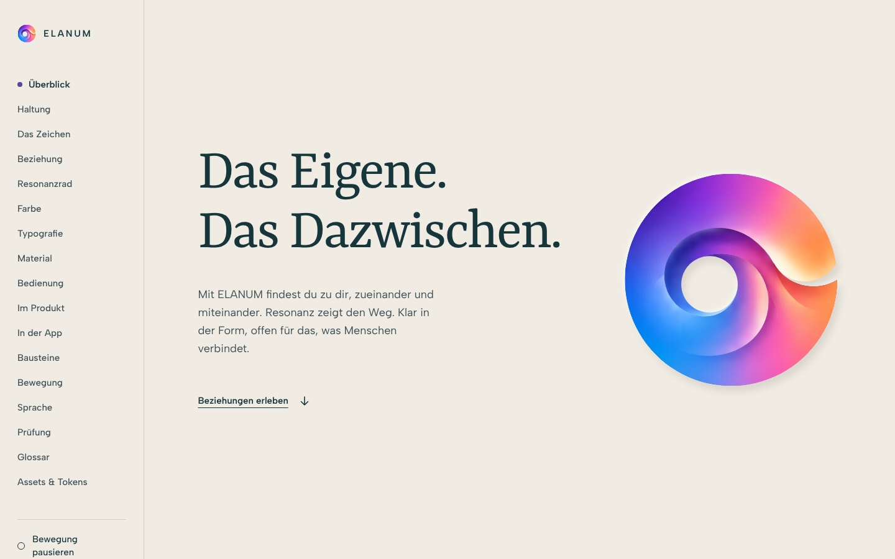
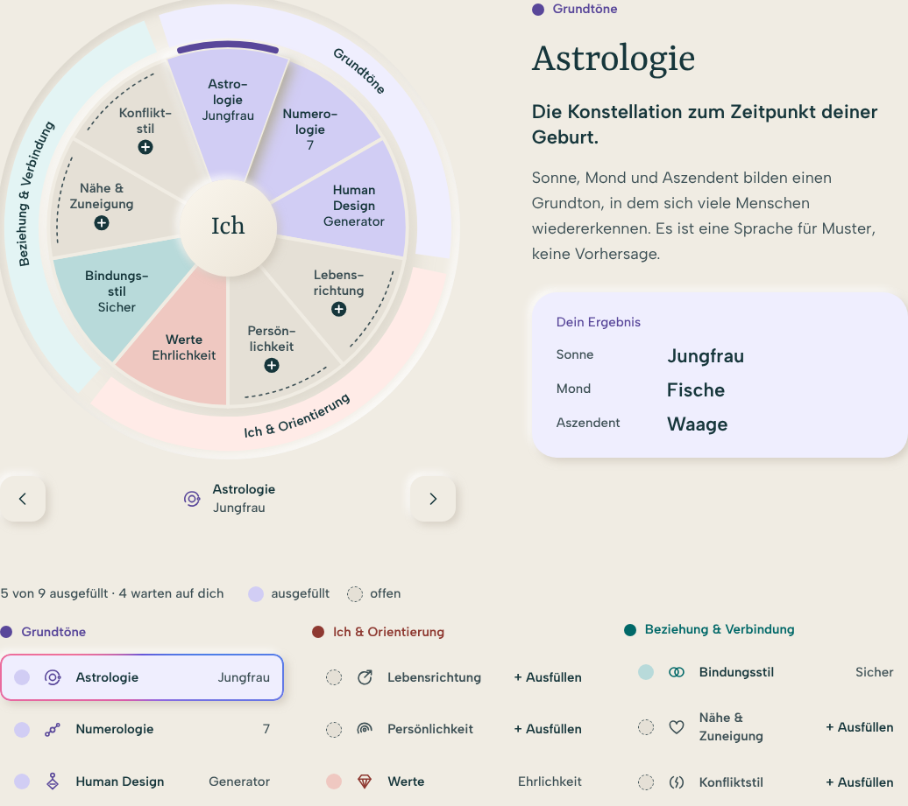
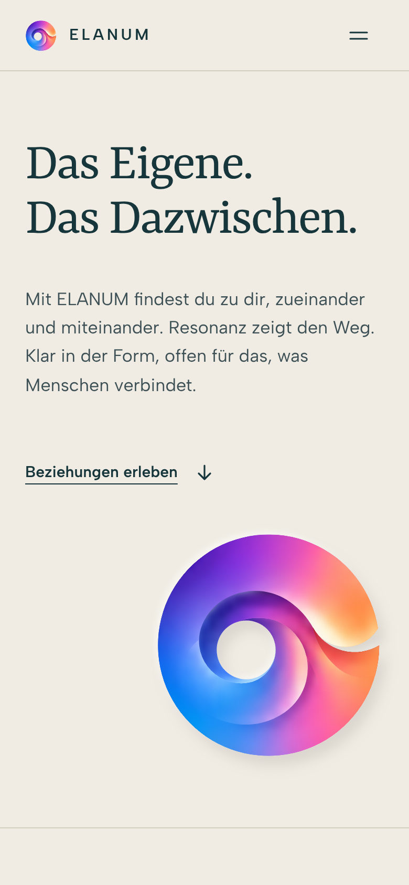

# ELANUM Gestaltungsatlas 4.8



<table>
  <tr>
    <td width="66%"></td>
    <td width="34%"></td>
  </tr>
  <tr>
    <td>Resonanzrad</td>
    <td>Auf dem Telefon</td>
  </tr>
</table>

Der interaktive ELANUM-Gestaltungsatlas im Stil **Soft 3D Relief**, mit den Bausteinen Resonanzrad, Umfeld, Beziehungsraum sowie Weg und Tageslinie. Im Zentrum steht das Resonanzrad mit seinen neun Elementen.

[Atlas öffnen](index.html) · [Gestaltungsnotizen](DESIGN-NOTES.md) · [Bausteine](components/)

**Benennung:** Im Zentrum steht das Resonanzrad mit neun Elementen. ELANUM hat drei Kosmen: den **Resonanzkosmos** als Einstieg, daneben den **Datingkosmos** und den **Erlebniskosmos**. Verbindlich ist das [Glossar](GLOSSAR.md).

## Was der Atlas zeigt

- **Zeichen:** das ELANUM-Zeichen, vollständig aus Kreisbögen konstruiert, alle Radien im Goldenen Schnitt. Spektrum, Ink, Invers, Papierrelief und Blueprint. Das Zeichen bewegt sich nie.
- **Typografie:** fünf Stufen. Albert Sans trägt die Bedienung, Yrsa ist die Stimme und erscheint nur gross. Kein Kursiv, nichts unter 15 px.
- **Farbe:** neutrale Flächen, drei ausgeglichene Bereichsfarben des Resonanzrads (Violett, Koralle, Petrol) mit Tief, Fläche für ausgefüllte Elemente und Hauch; offene Elemente grau mit Plus, das Markenspektrum nur für Zeichen und Verbindung, kräftige Statusfarben mit Zeichen und Balken.
- **Material:** warme Reliefoberfläche, Licht von links oben, angehobene Bedienung, vertiefte Eingaben.
- **Bausteine:** Resonanzrad, Umfeld, Beziehungsraum, Weg und Tageslinie, je als eigene Seite unter `components/` und im Atlas eingebunden.
- **Bewegung:** erklärend statt nur einblendend. Das Resonanzrad baut sich beim Scrollen auf, Kreise rücken zusammen, Spuren zeichnen sich. Pause und reduzierte Bewegung wirken überall.

## Lokal öffnen

Das Repository herunterladen und `index.html` im Browser öffnen. Alle Dateien und den Ordner `assets/` zusammen behalten. GitHub selbst zeigt HTML als Quelltext.

Alternativ mit Git und Python 3:

```bash
git clone --branch main https://github.com/maindnow/elanum-design.git
cd elanum-design
python3 tools/serve.py
```

Danach [http://127.0.0.1:4173](http://127.0.0.1:4173) öffnen. Den Server mit `Ctrl+C` beenden. `tools/serve.py` schaltet den Browser-Cache ab, so zeigt der Browser nach einem Wechsel des Branches nie einen alten Stand.

Kein Paketmanager, Build oder Backend erforderlich. Schriften und SVG-Assets liegen lokal. Die Eingaben dienen nur der aktuellen Vorschau, ohne Versand oder dauerhafte Speicherung.

## Aufbau

| Datei | Aufgabe |
| --- | --- |
| [index.html](index.html) | Atlas mit allen Kapiteln |
| [tokens.css](tokens.css) | Eine Quelle für Farben, Schrift, Raum, Relief und Bewegung |
| [base.css](base.css) | Gemeinsame Bausteine: Schriftstufen, Buttons, Status, Stationslinie, Seitenrahmen |
| [style.css](style.css) | Layout des Atlas |
| [app.js](app.js) | Bedienlogik des Atlas |
| [components/](components/) | Bausteine als eigene Seiten: `resonanzrad`, `umfeld`, `beziehungsraum`, `weg` |
| [assets/boot.js](assets/boot.js) | Versteck-Guard, Schriften unter `file://`, GSAP nach dem ersten Paint |
| [assets/motion.js](assets/motion.js) | Alle Bewegung, deklarativ über `data-anim` |
| [assets/vendor/gsap/](assets/vendor/gsap/) | GSAP 3.15 lokal, mit Lizenzhinweis |
| [tools/embed-fonts.py](tools/embed-fonts.py) | Erzeugt `assets/fonts/fonts-embedded.css` neu |
| [tools/build_logo_circles.py](tools/build_logo_circles.py) | Erzeugt das ELANUM-Zeichen im Goldenen Schnitt (Ink, Spektrum, Blueprint), prüft Knicke; mit `--masks` die Relief-Maske. Nur Python-Standardbibliothek |
| [tools/serve.py](tools/serve.py) | Lokaler Server auf Port 4173 ohne Browser-Cache. Nur Python-Standardbibliothek |
| [tools/screenshots.js](tools/screenshots.js) | Erzeugt die Screenshots in `docs/screenshots/` neu (Server auf Port 4173, braucht Playwright) |
| [assets/glossar.js](assets/glossar.js) | Glossar: die eine Quelle aller Begriffe |
| [GLOSSAR.md](GLOSSAR.md) | Glossar als Datei, erzeugt mit `node tools/glossar-md.js` |
| [DESIGN-NOTES.md](DESIGN-NOTES.md) | Gestaltungs- und Konstruktionsentscheidungen |

Die Stylesheets laden in der Reihenfolge `tokens.css`, `base.css`, Element-Stylesheets, `style.css`.

## Gestaltungsregeln

- **Zeichen aus Kreisen.** Gültig ist `-Harmonic`: jede Kontur ein Kreisbogen, alle Radien aus der Reihe R · φ^(−k/4) (Goldener Schnitt), Übergänge ohne Knick. `ELANUM-Konstruktion-Harmonic.svg` zeigt die Konstruktion. Diese Dateien nie von Hand bearbeiten, sondern mit `python3 tools/build_logo_circles.py` neu erzeugen; die Relief-Maske in `app.js` (`RELIEF_MASK`) kommt aus `python3 tools/build_logo_circles.py --masks`. Dateien ohne Suffix sind die unveränderten Quellen, `-Curves` ist die frühere Kurvenkorrektur, `-Geometrisch` die verworfene Alternative aus sechs Grundkreisen. Für kleine Darstellungen die flachen Varianten verwenden.
- **Fünf Schriftstufen.** Display, Titel, Überschrift, Text, Label. Neue Texte verwenden eine dieser Stufen.
- **Farbe hat eine Rolle.** Neutral, Bereich oder Status. Weisse Schrift nur auf Tief, Ink auf dem Hauch; auf den Elementen im Rad steht Text nur in Ink.
- **Raum statt Rahmen.** Abstand gliedert, Linien trennen nur Kapitel.
- **Bewegung erklärt und bleibt kontrollierbar.** Jede Animation zeigt eine Beziehung, Reihenfolge oder einen Zustand. Keine Animation versteckt Inhalte dauerhaft; Pause, Tastatur und `prefers-reduced-motion` beenden alle Auftritte.
- **Begriffe aus dem Glossar.** Neue oder geänderte Begriffe nur in `assets/glossar.js`, danach `node tools/glossar-md.js`.
- **Dokumentation mitpflegen.** Bei Änderungen an Tokens `tokens.css` anpassen; Palette und Tokenblock lesen die Werte daraus. Nach Änderungen an Schriften `python3 tools/embed-fonts.py` ausführen.

## Prüfen

```bash
for f in app.js assets/*.js components/*/*.js; do node --check "$f"; done
python3 tools/build_logo_circles.py
git diff --check
```

Zusätzlich im Browser, für den Atlas und jede Seite unter `components/`:

- Desktop, Tablet und Telefon: kein horizontaler Überlauf, Texte nie unter 15 px.
- Resonanzrad: Auswahl per Tipp, Liste und Tastatur; Ausfüllstatus über Farbe und Kontur.
- Bewegung: Einstieg, festgehaltenes Resonanzrad-Kapitel, Pause, reduzierte Bewegung, Tab-Durchlauf.
- Assets: keine fehlenden Dateien oder Konsolenfehler, auch unter `file://`.

## Stand und Historie

4.8 benennt den Bereich Grundtöne in Sterne & Ursprung um und kürzt Resonanz auf den Satz „Es schwingt zu dir, zu deinem Partner oder deinem Umfeld.“ 4.7 fasst den Begriff Resonanz neu: Es schwingt zu dir, zu deinem Partner oder deinem Umfeld. 4.6 benennt die drei Phasen als Kosmen neu: Resonanzkosmos, Datingkosmos, Erlebniskosmos. Umfeld und Beziehungsraum gehören jetzt zum Resonanzkosmos. 4.5 baut auf dem freigegebenen Stand 4.4 (`abb9939`) auf. Das Resonanzrad stammt aus dem persönlichen Rad im Repo-Stand `8995945` und ist überarbeitet. Die Git-Historie bleibt erhalten; ein Push auf GitHub ist kein Deployment. Für statisches Hosting das ganze Repository mit `index.html` als Einstieg bereitstellen.

## Schriften und Nutzungsrechte

Yrsa und Albert Sans sind lokal eingebunden. Ihre OFL-Lizenzen liegen unter [assets/fonts/](assets/fonts/). Diese Font-Lizenzen erteilen keine allgemeine Nutzungsfreigabe für ELANUM-Markenassets. GSAP steht unter der GreenSock Standard License, siehe [assets/vendor/gsap/](assets/vendor/gsap/).
